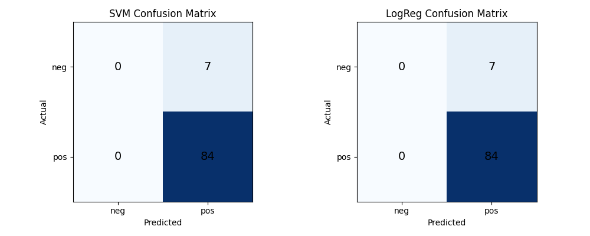

<div align="center">

# 🏟️ Athlytic

### Beyond the star rating: aspect-based sentiment analysis for sporting clubs


</div>

A 4.5★ average tells a club manager almost nothing. **Athlytic** reads every Google Maps review and breaks it down into **what** people are talking about and **how they feel about each thing**: facilities, prices, parking, food, cleanliness and more.

> *"The pool is beautiful, but the parking is awful!"*
> → **Facilities: positive** · **Parking: negative**

The pipeline is club-agnostic and was evaluated on **Gezira Sporting Club** (Zamalek, Cairo) as part of **CSE389 Natural Language Processing** at Ain Shams University.

---

## ✨ Highlights

- 🔍 **Aspect-Based Sentiment Analysis (ABSA)**: per-aspect sentiment across 10 club aspects, computed only on the sentences that mention each aspect
- 🧠 **Classical NLP end to end**: tokenisation, POS tagging, stemming vs lemmatisation, WordNet semantics, NER, dependency parsing and bigram language models
- 🤖 **ML baselines**: TF-IDF with Linear SVM and Logistic Regression, compared against lexicon-based VADER
- 🏁 **Competitor detection**: finds reviews that compare the club with rival clubs
- 📊 **Interactive Streamlit dashboard** that walks through every pipeline step with Plotly charts

## 📊 Results: what Gezira members actually think

From **339** English reviews (after cleaning, de-duplication and language filtering):

| Aspect | Mentions | 👍 Positive | 👎 Negative |
|---|---:|---:|---:|
| Community | 139 | **79.1%** | 20.9% |
| Food & Beverages | 108 | 73.1% | 26.9% |
| Facilities | 83 | 68.7% | 31.3% |
| Greenery | 73 | 63.0% | 37.0% |
| Service | 71 | 74.6% | 25.4% |
| Prices | 65 | 55.4% | 44.6% |
| Cleanliness | 44 | 75.0% | 25.0% |
| Crowd | 29 | 58.6% | 41.4% |
| Kids Area | 28 | 64.3% | 35.7% |
| Parking | 18 | 38.9% | **61.1%** |

**Takeaway:** the community and the food are the club's strengths, while **parking is the one aspect where complaints outnumber praise**. Prices are the most divisive. A single star average would hide all of this.

### Baseline sentiment models

| Model | Accuracy | F1 |
|---|---|---|
| TF-IDF + Linear SVM | ~0.85–0.92 | ~0.90–0.95 |
| TF-IDF + Logistic Regression | ~0.85–0.92 | ~0.90–0.95 |



> The scores vary with the random split and are inflated by class imbalance (≈88% of reviews are 4–5★), which is exactly why per-aspect analysis is more useful than overall sentiment.

## 🧩 Pipeline

```
Google Maps reviews (JSON)
  │
  ├─  1. Load & clean          de-duplicate, English-only (langdetect)
  ├─  2. Preprocessing         tokenise, stopwords, POS tags, Porter/Snowball vs WordNet lemmatiser
  ├─  3. WordNet explorer      synsets, hypernyms/hyponyms, Wu-Palmer similarity
  ├─  4. Competitor detection  regex word-boundary matching
  ├─  5. Syntax analysis       spaCy NER + dependency parsing → noun–adjective pairs
  ├─  6. Aspect matching       dictionary of 10 club aspects
  ├─  7. Bigram LM             NLTK ConditionalFreqDist
  ├─  8. VADER sentiment       lexicon-based, compared with star labels
  ├─  9. ML baselines          TF-IDF → Linear SVM / Logistic Regression
  ├─ 10. ABSA                  VADER on aspect-specific sentences only
  ├─ 11. Aggregate analytics   → gezira_analytics.json
  └─ 12. Model comparison      accuracy & F1
```

## 🚀 Getting started

```bash
git clone https://github.com/Aser-S/Athlytic.git
cd Athlytic
pip install -r requirements.txt
python -m spacy download en_core_web_sm
```

**Run the full pipeline** (prints every step, writes `gezira_analytics.json` and `confusion_matrix.png`):

```bash
python pipeline.py
```

**Or explore it interactively:**

```bash
streamlit run dashboard.py
```

Then open http://localhost:8501. NLTK data downloads automatically on first run. See [HOW_TO_RUN.md](HOW_TO_RUN.md) for troubleshooting.

## 📁 Project structure

```
Athlytic/
├── pipeline.py             # the 12-step NLP pipeline (CLI)
├── dashboard.py            # Streamlit dashboard for every step
├── data/                   # anonymised Google Maps reviews (text, stars, date)
├── gezira_analytics.json   # per-aspect sentiment output
├── confusion_matrix.png    # baseline model evaluation
├── REPORT.md               # full project report
└── HOW_TO_RUN.md           # setup and troubleshooting
```

## 🔒 Data & privacy

Reviews were collected from Google Maps with an online scraping tool. The published dataset is **anonymised**: reviewer names, profile links, IDs and photos were removed, and only the review text, star rating, date and language are kept.

## ⚠️ Limitations

- Class imbalance (≈88% positive) inflates the baseline accuracy
- English reviews only; Arabic reviews are filtered out
- Aspect detection is keyword-based and can miss unusual phrasing
- Classical ML and lexicon methods only (no transformers), in line with the course scope

## 👥 Team

Built for **CSE389 Natural Language Processing**, Ain Shams University, Spring 2026:

- **Aser Sherif**
- **Mohamed Ahmed Beder**
- **Omar Yasser Alashker**
